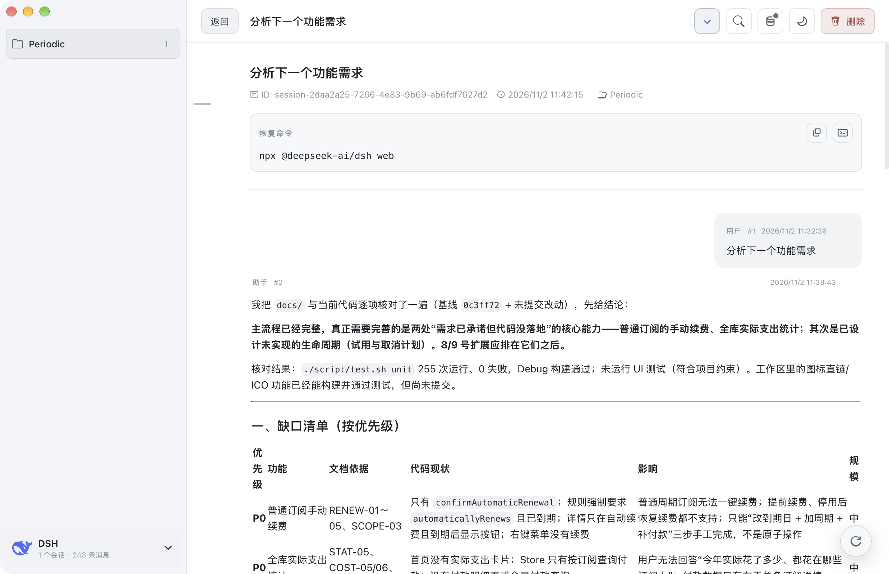
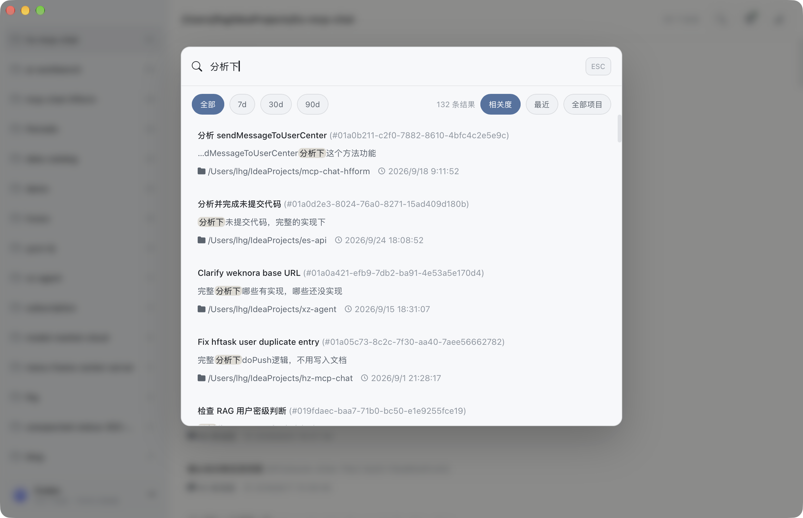
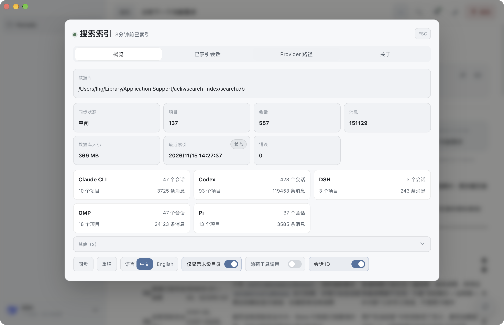
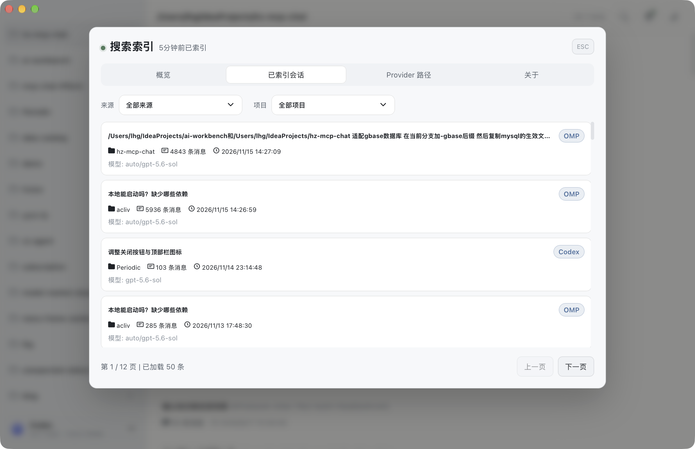

# ACLIV

ACLIV 是一个 AI CLI 会话历史查看器，帮助你在一个界面中浏览、搜索和继续不同 AI 编程工具产生的本地会话。

支持 Windows、macOS 桌面端，以及适合 Linux 服务器部署的 Web 模式。

## 功能

- 统一浏览 Claude、Codex、Gemini、OpenClaw、OpenCode、Pi、OMP 和 DSH 会话
- 按项目和 Provider 分类，按最近活跃时间排序
- 全文搜索历史消息，并快速跳转到匹配位置
- 展示 Markdown、代码块、Mermaid、thinking 和工具调用过程
- 支持 fork、分支和子代理会话
- 支持会话恢复命令、路径复制和安全删除
- 支持暗色与亮色主题

## Screenshots

| Main Overview | Search Dialog |
| :-----------: | :-----------: |
|  |  |

| Search Index Panel | Session Detail |
| :----------------: | :------------: |
|  |  |

## 下载

桌面安装包可从 [GitHub Releases](https://github.com/occva/acliv/releases/latest) 下载。

## 本地开发

环境要求：Node.js 18+、Rust stable。

```bash
npm install
npm exec tauri dev
```

启动 Web 模式：

```bash
npm run web:start
```

默认访问地址为 `http://127.0.0.1:17860`。

## Linux 部署

```bash
curl -fsSL https://raw.githubusercontent.com/occva/acliv/master/deploy/install.sh | sudo env ACLIV_REPO_BRANCH=master bash
```

安装脚本会自动生成 Web 登录账号密码、探测常见 Provider 目录并启动 Docker 服务。

如需关闭 Web 登录验证，可在 `deploy/.env` 中设置：

```bash
ACLIV_WEB_AUTH_ENABLED=0
```

关闭验证后所有 Web 路由均可直接访问，请仅在可信网络中使用。

## 项目结构

```text
.
├── assets/screenshots/       # README 截图
├── deploy/                   # Docker 与 Linux 部署
├── docs/                     # 设计文档与发布说明
├── public/                   # 图标与全局样式
├── scripts/                  # 检查、构建与发布脚本
├── src/                      # Svelte 前端
├── src-tauri/
│   ├── src/
│   │   ├── session_manager/  # Provider 会话解析
│   │   └── search_index/     # 搜索索引
│   └── web/                  # 独立 Web 服务
└── .github/workflows/        # CI 与发布工作流
```

## License

MIT
